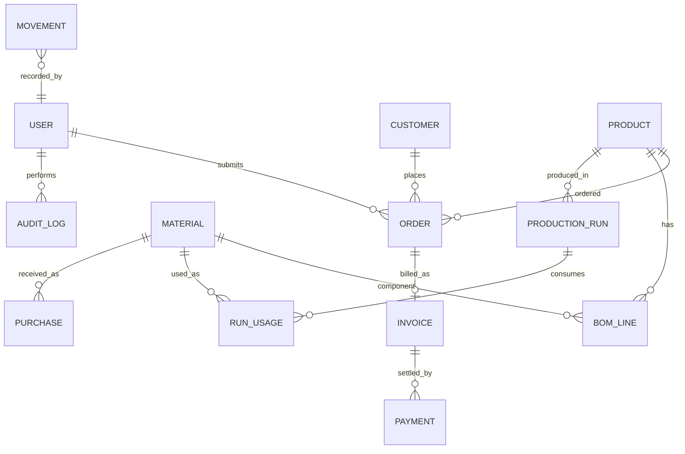

# Design note — Order-to-Audit System

## Data model

Core entities: `User` (role), `Customer`, `Product`, `Material`, `BOMLine`, `Order`, `Invoice`, `Payment`, `Purchase`, `ProductionRun`, `RunUsage`, `Movement`, and `AuditLog`.

## Stock and BOM computation

Stock is represented as integer thousandths of the displayed base unit (e.g. kg × 1,000, pieces × 1,000). A purchase receipt adds quantity and writes a positive `Movement`; a production issue subtracts actual material quantities and writes negative movements; good output adds finished packets; dispatch subtracts finished packets. Each movement records its source document type and ID. The corresponding on-hand balance is changed in the same SQL transaction, so a failed validation rolls back both the balance and ledger write.

For a run, planned component quantity = BOM quantity per batch × batch count. Actual quantities are entered by the supervisor (or default to BOM). Variance % = (actual − planned) / planned × 100. Yield variance = (actual good packets − expected packets) / expected packets × 100. More than 3% adverse yield or consumption variance should be treated as an alert; the prototype highlights yield and exposes material variance percentages in the run detail.

## Costing

Moving weighted-average valuation: new average rate = (old stock quantity × old rate + receipt quantity × receipt rate) / (old quantity + receipt quantity). All rates and monetary values are integer paise. Run material cost = Σ(actual quantity × weighted-average rate). Labour and gas/power are direct run overheads entered by the supervisor. Cost per good packet = (material cost + labour + utilities) / actual good output. This direct allocation is chosen because the benchmark provides run-specific labour and energy amounts.

## Controls and auditability

Role gates separate salesman order entry, admin approvals/billing/payments, production posting, and auditor reporting. Posted invoice records are not exposed to deletion routes. Audit events are written for order approvals/rejections, invoice posting, dispatch, purchase, production, and payments. The demo's SQLite database is local and should be replaced with PostgreSQL, stronger route tests, CSRF protection, and managed credentials before public use.
